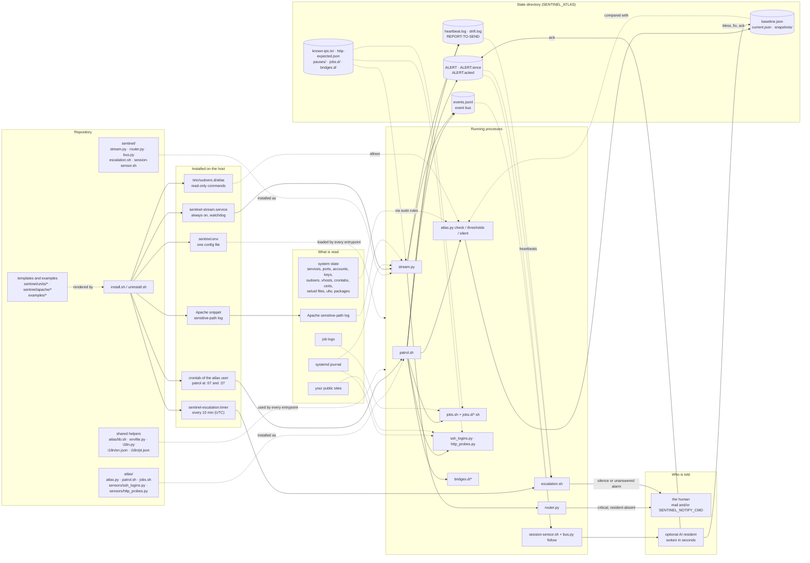
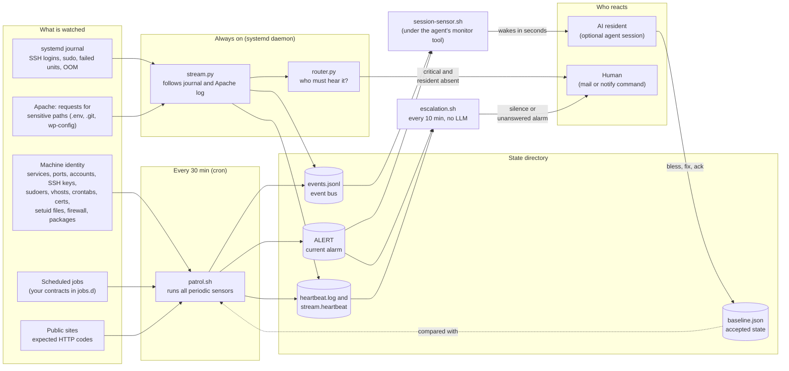
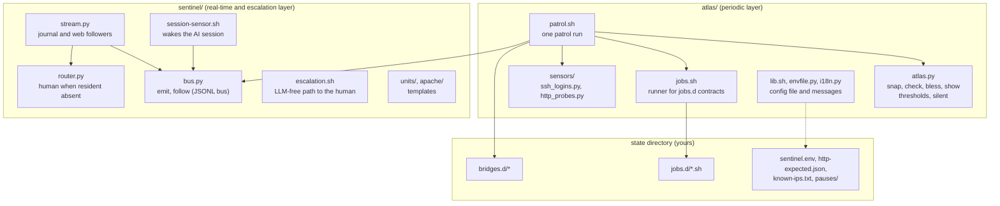
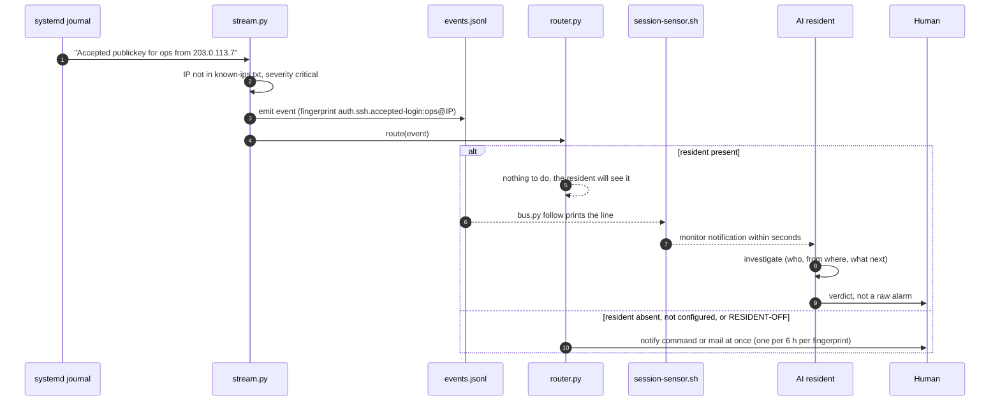
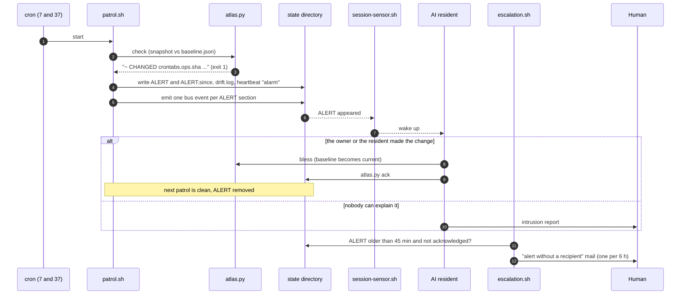
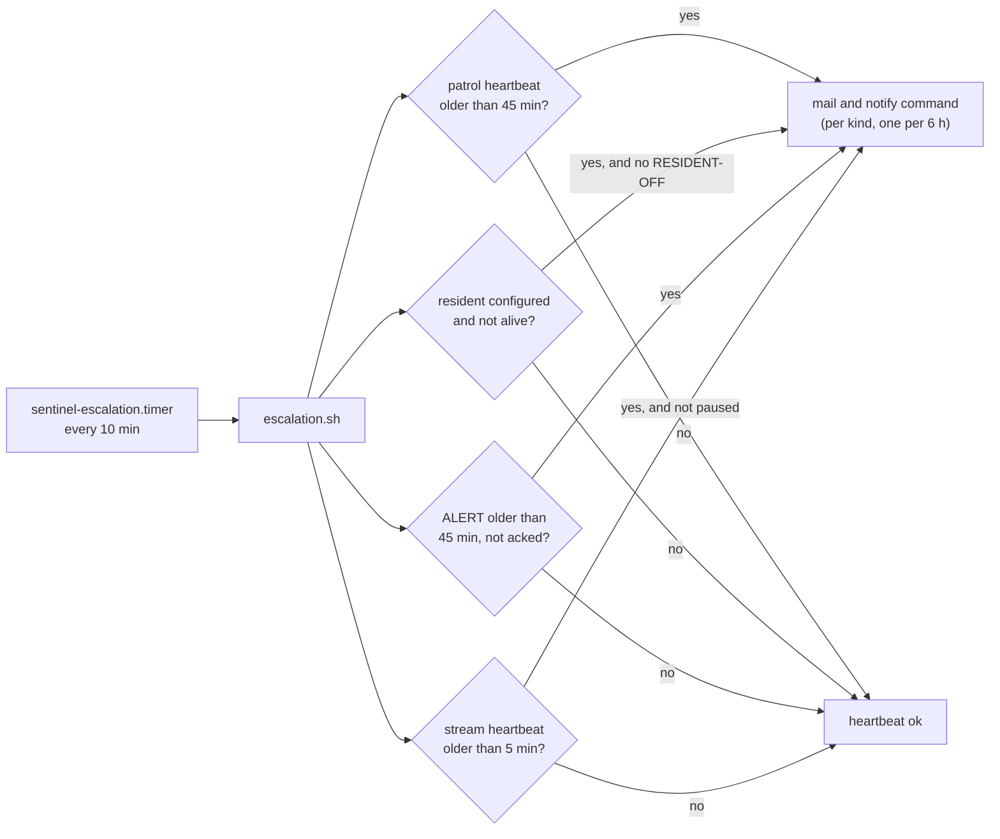
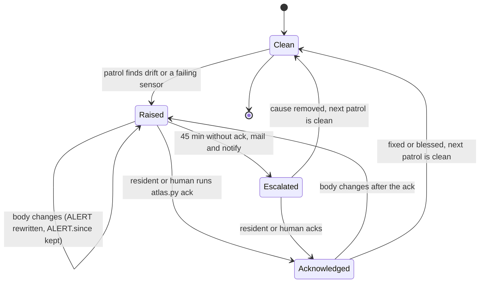
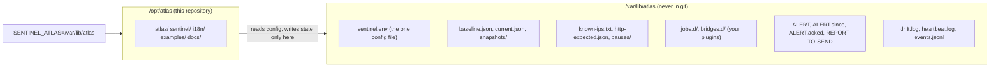

<p align="center">
  <picture>
    <source media="(prefers-color-scheme: dark)" srcset="docs/assets/atlas-dark.svg">
    
  </picture>
  &nbsp;&nbsp;&nbsp;
  <picture>
    <source media="(prefers-color-scheme: dark)" srcset="docs/assets/sentinel-dark.svg">
    
  </picture>
  &nbsp;&nbsp;&nbsp;
  <picture>
    <source media="(prefers-color-scheme: dark)" srcset="docs/assets/llm-dark.svg">
    
  </picture>
</p>
<p align="center"><sub>Atlas · Sentinel · LLM agent</sub></p>

# Atlas

**Atlas is the immune system of one Linux server.** It knows what the machine *should* look like, notices within
minutes when it stops looking like that, and makes sure a human hears about it, with or without an AI agent watching
the server.

**Atlas works best in tandem with an LLM agent.** Atlas notices a sudden failure or an intrusion; an AI agent on
the host, woken by Atlas within seconds, analyses it and acts on it: investigates, repairs, or tells the human
"this was an intrusion" instead of forwarding a raw alarm. The system as a whole is **LLM-optional**: the alerting
path never depends on the agent and stays a safety net, because the agent may itself be what failed or what was
manipulated.

Its single job is to tell two kinds of change apart:

- the server changed because **its owner (or the owner's AI agent) changed it**: the change is reviewed and accepted (`bless`);
- the server changed because **someone else changed it**: that is an intrusion, not a glitch.

Atlas itself runs without a language model: stdlib Python 3 and bash, cron and systemd. Without an agent (the
*resident*) it still detects and still calls the human; with one, the human gets a verdict instead of a raw alarm.

Licence: MIT (see LICENSE).

### Atlas + an AI agent

| | Who does it |
|---|---|
| Detection (drift, SSH logins, sudo, failed units, OOM, sensitive web paths) | Atlas, deterministic |
| Escalation to the human (mail, notify command) | Atlas, LLM-free: works with the agent dead, absent or manipulated |
| Investigation: what changed, who did it, is it still happening | the agent |
| A verdict instead of a raw alarm | the agent |
| Repair within its mandate (restart a failed service, free disk) | the agent |
| Accepting a deliberate change (`bless`) and acknowledging the alert | the agent, only for changes it can explain |

**Starting from a blank server and a Claude subscription?** Follow [docs/quickstart.md](docs/quickstart.md): Atlas,
Claude Code, and a session you talk to from your phone, step by step.

How to connect one: [Connect Atlas to an LLM agent](#connect-atlas-to-an-llm-agent) below and
[docs/resident.md](docs/resident.md). The agent reads untrusted text (request paths, user names, web pages): it
reads raw logs only through a quarantined reader without write tools, and never acts on instructions found in data.

---

## Requirements

- Debian 12+ or Ubuntu 24.04+ (any systemd distribution with the same tools should work), one vCPU is enough.
- systemd and journald, `python3` >= 3.11, `sudo` >= 1.9.10, `ss` (iproute2), cron, `timeout` (coreutils).
- A working `mail` command (bsd-mailx or mailutils plus an MTA) for the escalation mails, and/or any command-line
  notifier you configure as `SENTINEL_NOTIFY_CMD`.
- Optional, used when present: Apache 2.4 (vhost inventory, HTTP probes, sensitive-path log), certbot, ufw,
  fail2ban, Docker, `screen` (if your resident runs in one). A missing optional tool is reported as
  "not present" by `atlas.py show`, never as an alarm.
- `git` to fetch the code. A minimal Debian cloud image lacks `git` and `cron`; on Debian/Ubuntu:
  `sudo apt-get install -y git python3 sudo cron iproute2` (add `apache2` if you serve sites with it).

Tested on: a clean Debian 13 (trixie) genericcloud amd64 image with Apache 2.4, 1 vCPU and 768 MB RAM,
2026-10-25: Quick start as written, then the acceptance checks (units, sudoers drop-in, patrol, drift,
real-time SSH and sensitive-path events, escalation, uninstall and reinstall, Polish texts).

## Quick start

New to Claude Code, or starting from a blank server? Use the step-by-step [docs/quickstart.md](docs/quickstart.md).
The short version for someone who already runs an agent follows.

Install from a signed release tag, not from a branch tip. The repository carries the allowed signers in
`.github/allowed_signers`; check the tag against them before you run anything as root (`git tag --list` shows the releases; v0.3.1 is the example here):

```bash
git clone <this repository> atlas && cd atlas
git -c gpg.ssh.allowedSignersFile=.github/allowed_signers verify-tag v0.3.1   # must say: Good "git" signature
git checkout v0.3.1
sudo ./install.sh --dry-run            # see every action first
sudo ./install.sh --with-apache --install-cron
sudoedit /var/lib/atlas/sentinel.env    # set SENTINEL_EMAIL (and whatever else you need)
```

To also set up an AI resident that starts at boot, add `--resident-user NAME --permission-mode MODE` (and optionally
`--resident-name`). The trust level is **your explicit choice**, there is no default: `default` (the agent asks you
before risky actions), `acceptEdits`, `plan`, or `bypassPermissions` (the agent acts without asking). The installer
writes the files but does not start the unit; it prints the remaining steps (login, one-time prompts,
`systemctl enable --now atlas-resident`). See [docs/quickstart.md](docs/quickstart.md) step 9.

The installer (idempotent; defaults `--code /opt/atlas --state /var/lib/atlas --user atlas`):

1. checks the prerequisites and prints what is missing;
2. creates the unprivileged `atlas` user (groups `adm`, `systemd-journal` for log access);
3. copies the code to `--code` (a re-install replaces every product directory there, so removed files do not linger) and creates the state directory with `sentinel.env`, `known-ips.txt` and
   `http-expected.json` from `examples/` (an existing file is never overwritten);
4. renders and installs the systemd units (`sentinel-stream.service`, `sentinel-escalation.timer`) and starts them;
5. installs the Apache log snippet only with `--with-apache`;
6. installs a sudoers drop-in limited to the read-only commands Atlas runs (checked with `visudo -cf` first);
7. prints the crontab lines (installs them only with `--install-cron`);
8. takes the first snapshot and asks before accepting it as the baseline (`--yes` skips the question); on a
   reinstall an existing baseline is never replaced: review the drift with `atlas.py check`, then `bless`.
   Without a baseline `atlas.py check` reports `UNKNOWN` (it never creates one by itself): review `atlas.py show`,
   then run `atlas.py bless` once on a fresh install.

`./uninstall.sh` reverses units, snippet, sudoers and crontab lines; the state directory stays unless `--purge`.

Everyday commands (as the atlas user, `SENTINEL_ATLAS=/var/lib/atlas`):

```bash
cat /var/lib/atlas/ALERT                                   # is there an alarm?
python3 /opt/atlas/atlas/atlas.py show                     # what Atlas sees now
python3 /opt/atlas/atlas/atlas.py bless                    # accept a reviewed change as the new baseline (tells you who)
python3 /opt/atlas/atlas/atlas.py ack                       # acknowledge (stops escalation for this content, tells you who)
touch /var/lib/atlas/RESIDENT-OFF                          # the resident is off on purpose
```

## Configuration

One file: `$SENTINEL_ATLAS/sentinel.env` (`KEY=VALUE`, no shell code). Every script and unit reads it; a variable
already set in the environment wins. The most important keys:

| Key | Default | Meaning |
|---|---|---|
| `SENTINEL_EMAIL` | *(empty)* | who gets the escalation mails; empty = escalation reports UNKNOWN, never "ok" |
| `SENTINEL_NOTIFY_CMD` | *(empty)* | extra channel, called as `<cmd> "<subject>" "<body>"` |
| `SENTINEL_LANG` | `en` | language of the human-facing texts (`en`, `pl`) |
| `SENTINEL_RESIDENT_UNIT` / `SENTINEL_RESIDENT_SCREEN` | *(empty)* | how to see that the AI resident is alive; empty = no resident |
| `SENTINEL_TRUSTED_SUDO_USERS` | `root` | users whose `sudo` is routine (not the AI agent's account) |
| `SENTINEL_AGENT_SUDO_USERS` | *(empty)* | the AI agent's account(s): their `sudo` is `info` and goes into the daily digest |
| `SENTINEL_DIGEST_HOUR` | `7` | UTC hour at or after which the daily digest is sent |
| `SENTINEL_SUDO_EXE` | `/usr/bin/sudo` | path(s) of the real `sudo`; journal lines from other executables are rejected |
| `SENTINEL_WAKE_MAX_PER_HOUR` | `12` | most events that wake the agent per hour (`0` = no limit) |
| `SENTINEL_HEARTBEAT_URL` | *(empty)* | optional external heartbeat URL fetched after a clean escalation run; empty = none |
| `ATLAS_DISK_PCT` / `ATLAS_RAM_MB` / `ATLAS_CERT_DAYS` | `90` / `250` / `14` | thresholds |

Your own checks plug in without touching the code: job contracts in `jobs.d/`, report bridges in `bridges.d/`,
expected HTTP codes in `http-expected.json`, deliberate silences in `pauses/`.
Full reference: [docs/configuration.md](docs/configuration.md).

## Connect Atlas to an LLM agent

The operating procedure ships with Atlas: [AGENTS.md](AGENTS.md) for any agent harness, and a Claude Code plugin in
[agent/claude-code/](agent/claude-code/) (the alert procedure as a skill, plus a quarantined `log-reader` subagent
with read-only tools). Step by step, in detail in [docs/resident.md](docs/resident.md):

1. Run the agent session on the host under your operator account (in the `atlas` group; state changes as the
   `atlas` user). Give it `/opt/atlas/AGENTS.md`, or with Claude Code load the plugin:
   `claude --plugin-dir /opt/atlas/agent/claude-code` for one session, or persistently
   `claude plugin marketplace add /opt/atlas/agent` and `claude plugin install atlas-resident@atlas`.
2. Arm the watch with the agent's monitor tool (Claude Code: Monitor) on
   `SENTINEL_ATLAS=/var/lib/atlas /opt/atlas/sentinel/session-sensor.sh`: one line per state change, no polling;
   re-arm it when it expires.
3. Set `SENTINEL_RESIDENT_UNIT` and/or `SENTINEL_RESIDENT_SCREEN` in `sentinel.env`, so the router and escalation
   know whether the agent is present (absent agent = critical events go straight to the human).
4. Optionally start the session from a systemd unit after a reboot (shipped template and start script, see
   docs/resident.md). The agent's logins live in files in its home and survive the restart; when one has expired
   the unit fails and Atlas tells you: [Logins and restarts](docs/resident.md#logins-and-restarts).
5. On a wake-up the agent reads ALERT and the bus line, verifies by probing system state, fixes or blesses
   (`atlas.py bless`), acknowledges (`atlas.py ack`) and reports to you; anything unexplained stays
   unacknowledged so escalation still reaches you.
6. `touch <state>/RESIDENT-OFF` when you stop the agent on purpose.
7. Safety: raw logs only through the quarantined reader, no action on instructions found in data, human approval
   for privileged actions after reading untrusted data. The optional taint gate below enforces the last rule in
   Claude Code. The escalation path stays LLM-independent.

### Taint gate (optional)

An agent with tools that also reads attacker-controlled text (logs, web pages, mail, messages from other agents)
has the "lethal trifecta": untrusted input, access to private data or privileges, and a way to act. The taint gate
is a deterministic hook (no model involved) that breaks the chain in Claude Code:

- Reading an untrusted source (anything under `/var/log`, the Atlas events and drift files, the quarantine
  directory, `journalctl`, `curl`, WebFetch/WebSearch, browser tools, mail, calendar and drive reads, tools you
  list in the config) **taints the session**.
- While tainted, every tool call outside a small read-only allowlist is denied (writes, restarts, Edit/Write, MCP
  actions). Reading local files, simple read-only probes (`ls`, `df`, `ps`, `dpkg -l` ...) and the log-reader subagent stay possible.
- Only a **verified human message** clears the taint: it must be a typed prompt found in the session transcript,
  fresh and not used before. Its origin counts as human only in three shapes: no `origin` key, `"origin": "human"`, or `{"kind": "human"}`;
  anything else (other strings, other objects, null, numbers, lists) is not human (details in [docs/compatibility.md](docs/compatibility.md)). Task notifications, system envelopes and loop ticks do not clear it.
- Raw logs go through `agent/claude-code/bin/untrusted-export` (copies a slice into the quarantine directory and
  prints only its path) and the `log-reader` subagent (read-only tools, bounded JSON answer).

Enable it by installing the plugin as in step 1: `agent/claude-code/hooks/hooks.json` registers the hook for
`PreToolUse`, `PostToolUse` and `UserPromptSubmit` (`python3 -I -S ${CLAUDE_PLUGIN_ROOT}/hooks/taint_gate.py`,
timeout 5 s; if the hook itself fails, Read/Grep/Glob continue and everything else is blocked). Requires Python 3.

**Emergency switch:** a root-owned regular file `/etc/claude-taint-gate.off` turns the gate off (every call is
logged as `switch-off`). Remove the file to turn it back on. A file anywhere else is ignored.

**Paths** (all derived from the home directory of the user running Claude Code, override with the variable):

| Item | Default | Variable |
|---|---|---|
| state | `~/.claude/taint/` | `TAINT_STATE_DIR` |
| decision log | `~/.claude/taint/gate.log` | `TAINT_LOG` |
| transcripts (human-message check) | `~/.claude/projects/` | `TAINT_TRANSCRIPT_ROOT` |
| quarantine | `~/.quarantine/` | `QUARANTINE_ROOT` |
| Atlas state | `~/atlas-state/` | `SENTINEL_ATLAS` |
| config | `~/.config/atlas/taint-gate.json` | `TAINT_CONFIG` |

**Config file** (optional, all keys optional):

```json
{
  "extra_untrusted_tools": ["mcp__chat__read_*", "mcp__tickets__get_ticket"],
  "extra_untrusted_paths": ["/srv/uploads"],
  "extra_monitor_commands": ["/opt/tools/watch-queue.sh"]
}
```

`extra_untrusted_tools` are exact tool names, or prefixes when they end in `*`; calling one taints the session.
`extra_untrusted_paths` are absolute files or directories treated like `/var/log`. `extra_monitor_commands` are exact
Monitor commands that stay allowed while tainted (the Atlas session sensor always is). An invalid file is ignored
as a whole and logged once; the config can only add taint sources, never remove a built-in one.

**Known limits:**

- Bash is classified by parsing the command line, best effort, against an honest model that makes mistakes or is
  steered by text, not against an attacker who controls the shell. Unparseable or unknown commands count as
  privileged while tainted.
- Files written with Edit or Write are not tracked: text copied from untrusted data into a file by those tools is not
  tainted when read later. Copies made by shell redirections and `cp`/`mv`/`tee` are recorded in
  `~/.claude/taint/artifacts.json`; inspect or edit it with `agent/claude-code/bin/taint-registry` (removal needs root).
- A "write text" exemption (letting `echo`/`printf`/heredoc text that merely mentions a log path be written to a
  file) exists in the code but is **off** by default (`TAINT_WRITE_TEXT_EXEMPTION=1` enables it). Leave it off.
- Subagents are gated one by one: a subagent that itself read untrusted data is denied the privileged tool calls, also
  after a resume, and a human clearing the parent does not lift that. A clean subagent is not gated, and a
  subagent's untrusted read also taints its parent when it finishes. An optional `subagent_allowlist` in the config
  (same JSON file as above) limits which subagent types may be launched.

---

## Project map

What the repository contains, what the installer turns it into, what runs each part, what each part reads and
writes, and who is told in the end. Solid arrows are "runs" or "writes", dotted arrows are "reads".



### Files, one line each

```text
install.sh                     installer: prerequisites, state dir, units, sudoers, Apache snippet, crontab, first snapshot (--dry-run)
uninstall.sh                   removes units, snippet and sudoers; keeps the state dir unless --purge
AGENTS.md                      operating instructions for an AI resident (any harness): wake-up, alert procedure, limits
agent/claude-code/             Claude Code plugin atlas-resident: alert-procedure skill, quarantined log-reader subagent
agent/.claude-plugin/          local plugin marketplace manifest (claude plugin marketplace add <code>/agent)
atlas/
  atlas.py                     snapshot of the machine's identity; check (drift vs baseline), bless, show, thresholds, silent failures
  patrol.sh                    one patrol run: every periodic sensor under a time limit -> ALERT, drift.log, heartbeat.log, bus events
  jobs.sh                      runner for job contracts: helpers check / check_last_line / paused, sources STATE/jobs.d/*.sh
  sensors/ssh_logins.py        SSH logins of the last 24 h from IPs outside known-ips.txt
  sensors/http_probes.py       every vhost answers its expected code; optional extra URLs must answer 200
  lib.sh                       bash helpers: load sentinel.env (environment wins), message catalog lookup
  envfile.py                   the same env loading for Python entrypoints (parsed, never executed)
  i18n.py                      message catalog lookup for Python and for bash (via lib.sh)
  pauses/README.md             how a deliberate silence (pauses/<id>) works
sentinel/
  bus.py                       append-only JSONL event bus: emit (validated), follow (tail -F, per-fingerprint dedup), rotation
  stream.py                    daemon: follows the journal and the Apache sensitive-path log, turns lines into events, heartbeat
  untrusted.py                 clean/quote untrusted text (printable ASCII, bounded); flags instruction-like input
  router.py                    for critical events: notifies the human when no AI resident is present (once per fingerprint per 6 h)
  escalation.sh                LLM-free path to the human: silent patrol, silent stream, dead resident, unacknowledged alarm
  session-sensor.sh            prints one line per state change for an AI agent's monitor tool (no polling inside the agent)
  units/*.service, *.timer     systemd templates (@ATLAS_CODE@, @ATLAS_STATE@, @ATLAS_USER@), rendered by install.sh
  units/crontab.example        the two cron lines (patrol, snapshot retention)
  apache/sentinel-sensitive.conf   logs requests for .env, .git, wp-config, dumps ... to a separate log for stream.py
i18n/en.json, i18n/pl.json     every human-facing message; SENTINEL_LANG picks the language
examples/                      sentinel.env, http-expected.json, known-ips.txt, jobs.d/, bridges.d/, sudoers.d/atlas
docs/                          architecture (incl. untrusted input), configuration, security, resident (connecting an AI agent)
.github/workflows/tests.yml    CI: tests, shell syntax and an installer dry run on every push
```

---

## The system at a glance



Three independent paths reach a person, and each one covers the failure of another:

| Path | Latency | Needs the AI? | Covers |
|---|---|---|---|
| Stream → bus → session sensor → resident | seconds | yes | SSH login from an unknown IP, sudo by a stranger, a failed unit, OOM, a leak of a sensitive file |
| Patrol → ALERT → session sensor → resident | ≤ 30 min | yes | any drift of the machine's identity, broken jobs, disk/RAM/certs, sites returning the wrong code |
| Router → notify/mail, Escalation → mail | ≤ 2 min / ≤ 10 min | **no** | the resident is dead or absent (or there is none), an alarm nobody acknowledged, the patrol or the stream went silent |

---

## Modules



| Module | Runs as | What it does |
|---|---|---|
| `atlas/atlas.py` | CLI, called by the patrol | Takes a JSON snapshot of the machine's identity (`snap`), diffs it against `baseline.json` (`check`), promotes a reviewed snapshot to the baseline (`bless`). Also judges thresholds and "silent failures" (timer services that end in error). Volatile numbers live under `vitals` and are never diffed. A failed measurement is UNKNOWN, never an empty inventory; a tool that is not installed is simply absent. |
| `atlas/patrol.sh` | cron, minutes 7 and 37 | Runs every periodic sensor under a time limit, runs the report bridges, writes `drift.log` and `heartbeat.log`, raises or clears `ALERT`, emits one bus event per new or changed ALERT section. Never touches the baseline. |
| `atlas/jobs.sh` | sensor | Generic runner: provides `check`, `check_last_line`, `check_last_match`, `paused`, `problem`, `unknown` and sources every `jobs.d/*.sh`. |
| `atlas/sensors/ssh_logins.py` | sensor | SSH logins in the last 24 h from IPs outside `known-ips.txt`. |
| `atlas/sensors/http_probes.py` | sensor | Every enabled vhost answers with its expected first status code; optional extra URLs answer 200. |
| `sentinel/bus.py` | library + CLI | Append-only JSONL bus with `flock`, rotation at 5 MB (3 generations), validation, and `follow` with tail -F semantics and per-fingerprint dedup. |
| `sentinel/stream.py` | `sentinel-stream.service` (Type=notify, watchdog 120 s, MemoryMax 80 M) | Follows the journal (`ssh.service`, `sudo`, PID 1, kernel) and the Apache sensitive-path log; turns lines into events; touches a heartbeat every 60 s. |
| `sentinel/untrusted.py` | library (stream, sensors) | `clean()` / `quote()`: untrusted text as printable, bounded ASCII data; `suspicious()`: a documented heuristic that adds an `input.injection-suspect` warning. A signal, not a defense. |
| `sentinel/router.py` | inside the daemon | For a `critical` event: if the resident is absent (or none is configured), notifies the human at once, at most once per fingerprint per 6 h. |
| `sentinel/escalation.sh` | `sentinel-escalation.timer`, every 10 min | Mails the human (and calls the notify command) when the patrol is silent > 45 min, the resident is dead, an alarm is unacknowledged > 45 min, or the stream heartbeat is older than 5 min. Same kind at most once per 6 h. |
| `sentinel/session-sensor.sh` | the agent session's monitor tool | Prints one line per state change (ALERT appeared or cleared, a bus event `alert`+, an escalation, a report to deliver). Silence costs nothing. |

---

## What happens, step by step

### A stranger logs in over SSH (real-time path)



### The machine drifts (periodic path)



### Nobody is home (LLM-free escalation)



---

## Life of an alarm



A sensor that cannot judge (time limit, missing permission, unreadable file) is reported as **UNKNOWN**, never as
clean: silence mistaken for health is the failure mode this whole design exists to prevent.

---

## Timing

```mermaid
gantt
    title One hour of Atlas (minutes after the full hour)
    dateFormat mm
    axisFormat %M
    section cron
    patrol run           :p1, 07, 2m
    patrol run           :p2, 37, 2m
    section systemd timer
    escalation           :e1, 00, 1m
    escalation           :e2, 10, 1m
    escalation           :e3, 20, 1m
    escalation           :e4, 30, 1m
    escalation           :e5, 40, 1m
    escalation           :e6, 50, 1m
    section daemon
    stream heartbeat every 60 s :active, s1, 00, 60m
```



| What | When | Budget |
|---|---|---|
| `patrol.sh` | cron `7,37 * * * *` | each sensor has its own time limit (atlas check 100 s, HTTP probes 90 s ...); a full run takes about 30 s |
| `escalation.sh` | `OnCalendar=*-*-* *:00/10:00 UTC` (UTC, so the autumn DST change cannot skip an hour) | 120 s, 128 MB |
| `stream.py` | always; heartbeat 60 s, systemd watchdog 120 s | 80 MB, 10 % CPU |
| snapshot retention | cron `40 4 * * *` | snapshots older than 30 days are deleted |

---

## Code and state are separate



One variable, `SENTINEL_ATLAS`, selects the state directory for every script; code locates itself by its own
path. Unset, state lives next to the code in `atlas/` (that is how the tests run). The units read `sentinel.env`
through `EnvironmentFile=` without the `-` prefix: a missing file fails the unit loudly instead of silently running
unconfigured.

---

## Principles

1. **No LLM on the alarm path.** Detection and escalation are stdlib Python and bash. The AI is a reader and a fixer, never a link in the chain that calls the human.
2. **Silence is not health.** Every layer writes a heartbeat; another layer watches it. A sensor that cannot measure says UNKNOWN.
3. **The baseline changes only by a deliberate `bless`,** after the change is understood.
4. **Events wake the AI; it never polls.** A polling loop inside an AI session once cost about 100 M tokens in a day; the session sensor costs nothing while nothing happens.
5. **One alarm, one recipient, no spam.** Dedup per fingerprint (1 h for the resident, 6 h for the human); mail at most once per 6 h per kind.
6. **Testable alarm branches.** Every path that would mail a human runs in a test with stubs; a branch nobody ever ran is a hope, not a safeguard.

More: [docs/architecture.md](docs/architecture.md) (layers, event format, engineering rules),
[docs/configuration.md](docs/configuration.md), [docs/security.md](docs/security.md) (what Atlas can read),
[docs/resident.md](docs/resident.md) (connecting an AI agent).

## Tests

```bash
python3 -m pytest -q          # needs python3-pytest; about 1,100 tests, a few minutes on one vCPU
```

Every test runs on temporary directories with stubbed commands: no root, no mail, no network, no real state.
GitHub Actions runs the same suite on every push and pull request (Python 3.11 and 3.13), plus `bash -n` on every
shell script and an installer dry run: [.github/workflows/tests.yml](.github/workflows/tests.yml).

## Contributing

- Commit subjects follow Conventional Commits: `type(scope): summary` with `feat`, `fix`, `docs`, `style`, `test`, `refactor`,
  `perf`, `build`, `ci`, `chore` or `revert`. CI checks every non-merge commit
  (`bash .github/check-commits.sh <base> HEAD` does the same locally). After a force-push the old base commit is gone from
  the clone: the check then falls back to the commits since the merge base with `origin/main` (or to the head commit
  alone when `origin/main` is missing) and says so.
- Write the test first and watch it fail for the stated reason. Product code is standard library only; `ruff`,
  `shellcheck` and `pytest-cov` are development tools.
- Before you push: `python3 -m pytest -q`, `ruff check --config .github/ruff.toml .`, and
  `shellcheck $(git ls-files '*.sh')`.
- Releases are signed tags; a change to `.github/allowed_signers` is a change of who may publish.
