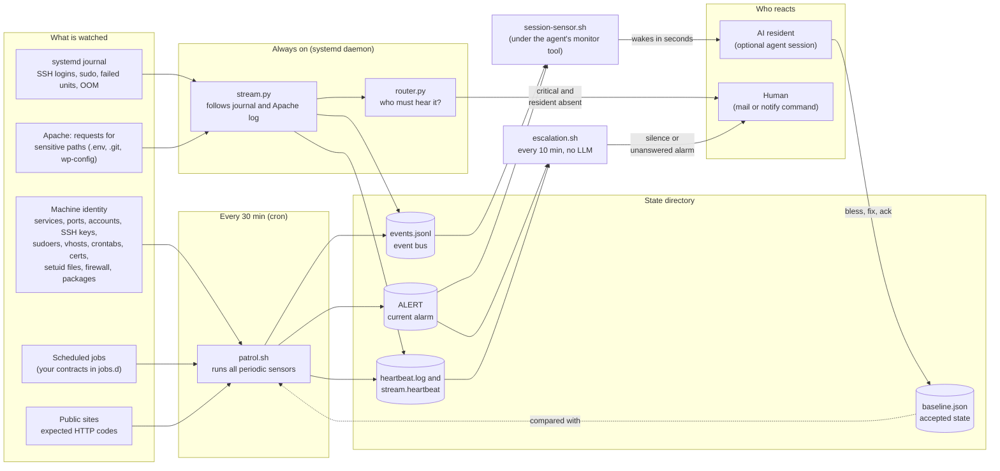
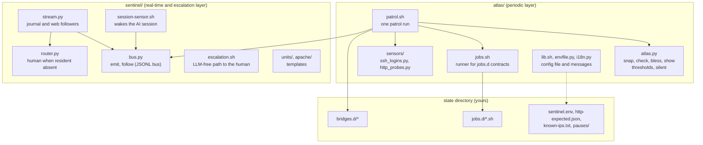
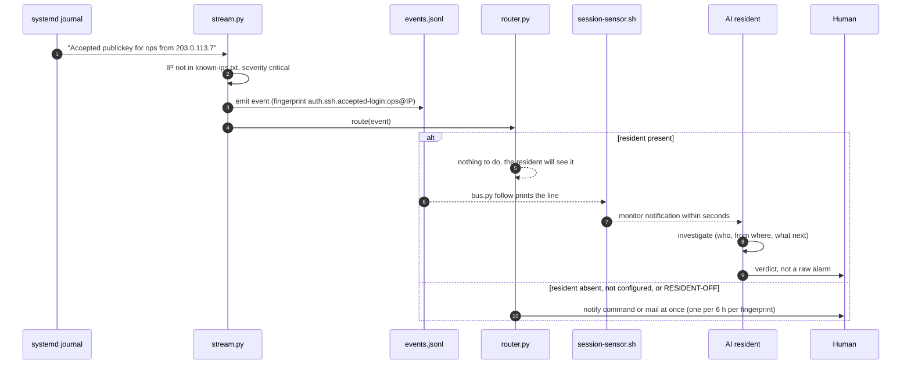
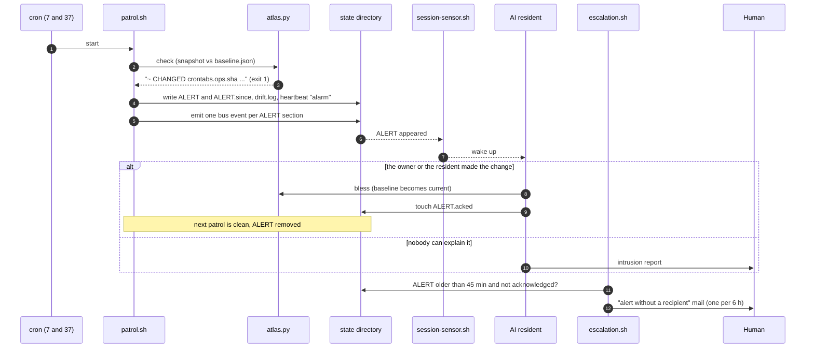
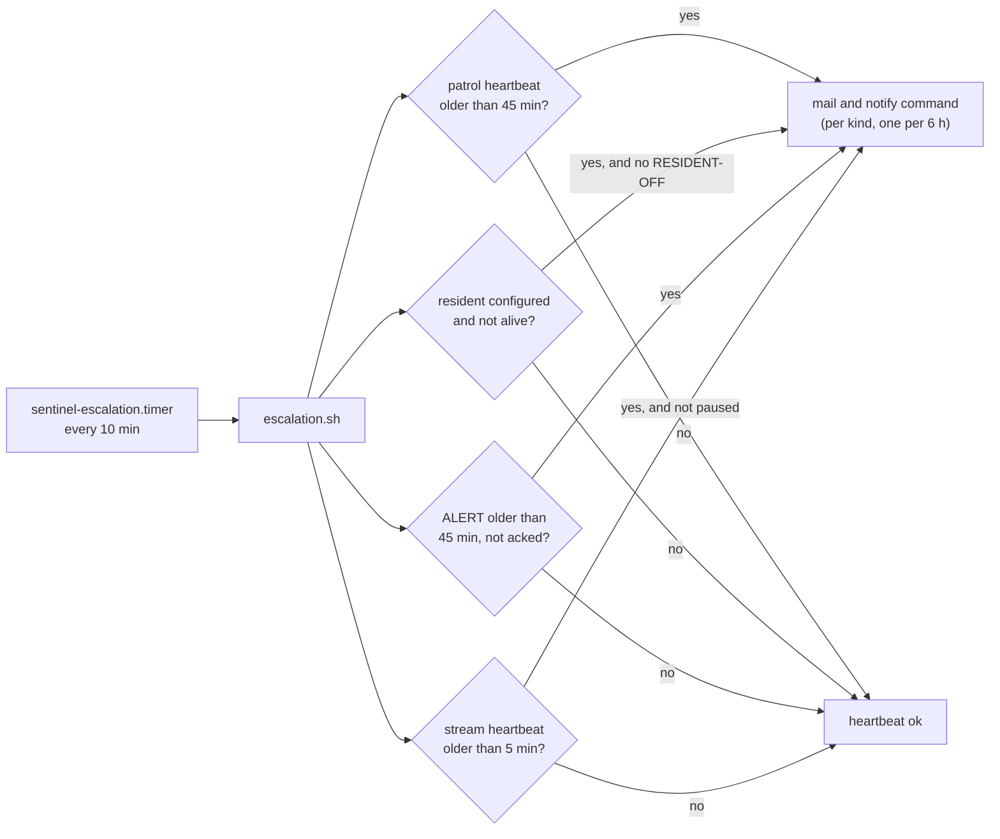
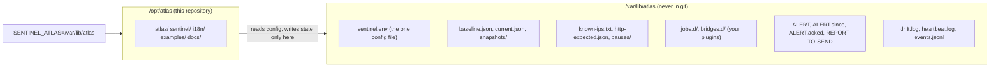

# Atlas

**Atlas is the immune system of one Linux server.** It knows what the machine *should* look like, notices within
minutes when it stops looking like that, and makes sure a human hears about it, with or without an AI agent watching
the server.

Its single job is to tell two kinds of change apart:

- the server changed because **its owner (or the owner's AI agent) changed it**: the change is reviewed and accepted (`bless`);
- the server changed because **someone else changed it**: that is an intrusion, not a glitch.

Everything below runs without a language model: stdlib Python 3 and bash, cron and systemd. An AI agent watching the
server (the *resident*, optional) makes the system complete: it is woken in seconds, investigates, repairs and gives
the human a verdict instead of a raw alarm. Without a resident, Atlas still detects and still calls the human.

Licence: not yet chosen.

---

## Requirements

- Debian 12+ or Ubuntu 24.04+ (any systemd distribution with the same tools should work), one vCPU is enough.
- systemd and journald, `python3` >= 3.11, `sudo` >= 1.9.10, `ss` (iproute2), cron, `timeout` (coreutils).
- A working `mail` command (bsd-mailx or mailutils plus an MTA) for the escalation mails, and/or any command-line
  notifier you configure as `SENTINEL_NOTIFY_CMD`.
- Optional, used when present: Apache 2.4 (vhost inventory, HTTP probes, sensitive-path log), certbot, ufw,
  fail2ban, Docker, `screen` (if your resident runs in one).

## Quick start

```bash
git clone <this repository> atlas && cd atlas
sudo ./install.sh --dry-run            # see every action first
sudo ./install.sh --with-apache --install-cron
sudoedit /var/lib/atlas/sentinel.env    # set SENTINEL_EMAIL (and whatever else you need)
```

The installer (idempotent; defaults `--code /opt/atlas --state /var/lib/atlas --user atlas`):

1. checks the prerequisites and prints what is missing;
2. creates the unprivileged `atlas` user (groups `adm`, `systemd-journal` for log access);
3. copies the code to `--code` and creates the state directory with `sentinel.env`, `known-ips.txt` and
   `http-expected.json` from `examples/` (an existing file is never overwritten);
4. renders and installs the systemd units (`sentinel-stream.service`, `sentinel-escalation.timer`) and starts them;
5. installs the Apache log snippet only with `--with-apache`;
6. installs a sudoers drop-in limited to the read-only commands Atlas runs (checked with `visudo -cf` first);
7. prints the crontab lines (installs them only with `--install-cron`);
8. takes the first snapshot and asks before accepting it as the baseline (`--yes` skips the question).

`./uninstall.sh` reverses units, snippet, sudoers and crontab lines; the state directory stays unless `--purge`.

Everyday commands (as the atlas user, `SENTINEL_ATLAS=/var/lib/atlas`):

```bash
cat /var/lib/atlas/ALERT                                   # is there an alarm?
python3 /opt/atlas/atlas/atlas.py show                     # what Atlas sees now
python3 /opt/atlas/atlas/atlas.py bless                    # accept a reviewed change as the new baseline
touch /var/lib/atlas/ALERT.acked                           # acknowledge (stops escalation for this content)
touch /var/lib/atlas/RESIDENT-OFF                          # the resident is off on purpose
```

## Configuration

One file: `$SENTINEL_ATLAS/sentinel.env` (`KEY=VALUE`, no shell code). Every script and unit reads it; a variable
already set in the environment wins. The most important keys:

| Key | Default | Meaning |
|---|---|---|
| `SENTINEL_EMAIL` | *(empty)* | who gets the escalation mails; empty = escalation reports UNKNOWN, never "ok" |
| `SENTINEL_NOTIFY_CMD` | *(empty)* | extra channel, called as `<cmd> "<subject>" "<body>"` |
| `SENTINEL_LANG` | `en` | language of the human-facing texts (`en`, `pl`) |
| `SENTINEL_RESIDENT_UNIT` / `SENTINEL_RESIDENT_SCREEN` | *(empty)* | how to see that the AI resident is alive; empty = no resident |
| `SENTINEL_TRUSTED_SUDO_USERS` | `root` | users whose `sudo` is routine |
| `ATLAS_DISK_PCT` / `ATLAS_RAM_MB` / `ATLAS_CERT_DAYS` | `90` / `250` / `14` | thresholds |

Your own checks plug in without touching the code: job contracts in `jobs.d/`, report bridges in `bridges.d/`,
expected HTTP codes in `http-expected.json`, deliberate silences in `pauses/`.
Full reference: [docs/configuration.md](docs/configuration.md).

---

## The system at a glance



Three independent paths reach a person, and each one covers the failure of another:

| Path | Latency | Needs the AI? | Covers |
|---|---|---|---|
| Stream → bus → session sensor → resident | seconds | yes | SSH login from an unknown IP, sudo by a stranger, a failed unit, OOM, a leak of a sensitive file |
| Patrol → ALERT → session sensor → resident | ≤ 30 min | yes | any drift of the machine's identity, broken jobs, disk/RAM/certs, sites returning the wrong code |
| Router → notify/mail, Escalation → mail | ≤ 2 min / ≤ 10 min | **no** | the resident is dead or absent (or there is none), an alarm nobody acknowledged, the patrol or the stream went silent |

---

## Modules



| Module | Runs as | What it does |
|---|---|---|
| `atlas/atlas.py` | CLI, called by the patrol | Takes a JSON snapshot of the machine's identity (`snap`), diffs it against `baseline.json` (`check`), promotes a reviewed snapshot to the baseline (`bless`). Also judges thresholds and "silent failures" (timer services that end in error). Volatile numbers live under `vitals` and are never diffed. A failed measurement is UNKNOWN, never an empty inventory; a tool that is not installed is simply absent. |
| `atlas/patrol.sh` | cron, minutes 7 and 37 | Runs every periodic sensor under a time limit, runs the report bridges, writes `drift.log` and `heartbeat.log`, raises or clears `ALERT`, emits one bus event per new or changed ALERT section. Never touches the baseline. |
| `atlas/jobs.sh` | sensor | Generic runner: provides `check`, `check_last_line`, `check_last_match`, `paused`, `problem`, `unknown` and sources every `jobs.d/*.sh`. |
| `atlas/sensors/ssh_logins.py` | sensor | SSH logins in the last 24 h from IPs outside `known-ips.txt`. |
| `atlas/sensors/http_probes.py` | sensor | Every enabled vhost answers with its expected first status code; optional extra URLs answer 200. |
| `sentinel/bus.py` | library + CLI | Append-only JSONL bus with `flock`, rotation at 5 MB (3 generations), validation, and `follow` with tail -F semantics and per-fingerprint dedup. |
| `sentinel/stream.py` | `sentinel-stream.service` (Type=notify, watchdog 120 s, MemoryMax 80 M) | Follows the journal (`ssh.service`, `sudo`, PID 1, kernel) and the Apache sensitive-path log; turns lines into events; touches a heartbeat every 60 s. |
| `sentinel/router.py` | inside the daemon | For a `critical` event: if the resident is absent (or none is configured), notifies the human at once, at most once per fingerprint per 6 h. |
| `sentinel/escalation.sh` | `sentinel-escalation.timer`, every 10 min | Mails the human (and calls the notify command) when the patrol is silent > 45 min, the resident is dead, an alarm is unacknowledged > 45 min, or the stream heartbeat is older than 5 min. Same kind at most once per 6 h. |
| `sentinel/session-sensor.sh` | the agent session's monitor tool | Prints one line per state change (ALERT appeared or cleared, a bus event `alert`+, an escalation, a report to deliver). Silence costs nothing. |

---

## What happens, step by step

### A stranger logs in over SSH (real-time path)



### The machine drifts (periodic path)



### Nobody is home (LLM-free escalation)



---

## Life of an alarm


A sensor that cannot judge (time limit, missing permission, unreadable file) is reported as **UNKNOWN**, never as
clean: silence mistaken for health is the failure mode this whole design exists to prevent.

---

## Timing

```mermaid
gantt
    title One hour of Atlas (minutes after the full hour)
    dateFormat mm
    axisFormat %M
    section cron
    patrol run           :p1, 07, 2m
    patrol run           :p2, 37, 2m
    section systemd timer
    escalation           :e1, 00, 1m
    escalation           :e2, 10, 1m
    escalation           :e3, 20, 1m
    escalation           :e4, 30, 1m
    escalation           :e5, 40, 1m
    escalation           :e6, 50, 1m
    section daemon
    stream heartbeat every 60 s :active, s1, 00, 60m
```



| What | When | Budget |
|---|---|---|
| `patrol.sh` | cron `7,37 * * * *` | each sensor has its own time limit (atlas check 100 s, HTTP probes 90 s ...); a full run takes about 30 s |
| `escalation.sh` | `OnCalendar=*:0/10` | 120 s, 128 MB |
| `stream.py` | always; heartbeat 60 s, systemd watchdog 120 s | 80 MB, 10 % CPU |
| snapshot retention | cron `40 4 * * *` | snapshots older than 30 days are deleted |

---

## Code and state are separate



One variable, `SENTINEL_ATLAS`, selects the state directory for every script; code locates itself by its own
path. Unset, state lives next to the code in `atlas/` (that is how the tests run). The units read `sentinel.env`
through `EnvironmentFile=` without the `-` prefix: a missing file fails the unit loudly instead of silently running
unconfigured.

---

## Principles

1. **No LLM on the alarm path.** Detection and escalation are stdlib Python and bash. The AI is a reader and a fixer, never a link in the chain that calls the human.
2. **Silence is not health.** Every layer writes a heartbeat; another layer watches it. A sensor that cannot measure says UNKNOWN.
3. **The baseline changes only by a deliberate `bless`,** after the change is understood.
4. **Events wake the AI; it never polls.** A polling loop inside an AI session once cost about 100 M tokens in a day; the session sensor costs nothing while nothing happens.
5. **One alarm, one recipient, no spam.** Dedup per fingerprint (1 h for the resident, 6 h for the human); mail at most once per 6 h per kind.
6. **Testable alarm branches.** Every path that would mail a human runs in a test with stubs; a branch nobody ever ran is a hope, not a safeguard.

More: [docs/architecture.md](docs/architecture.md) (layers, event format, engineering rules),
[docs/configuration.md](docs/configuration.md), [docs/security.md](docs/security.md) (what Atlas can read),
[docs/resident.md](docs/resident.md) (connecting an AI agent).

## Tests

```bash
python3 -m pytest -q          # needs python3-pytest; about 2 minutes on one vCPU
```

Every test runs on temporary directories with stubbed commands: no root, no mail, no network, no real state.
