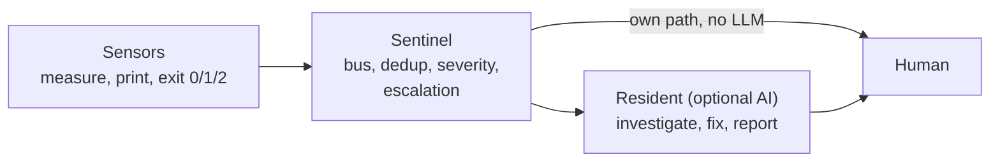

# Architecture

Atlas watches one server in three layers. The layers talk through **files and exit codes**, never through calls:
a file survives a process restart, a network outage and the death of an AI session; a call does not.



| Layer | Form | May | May not |
|---|---|---|---|
| **sensor** | one bash/Python file, stdlib only | measure, print findings, write its own heartbeat | interpret, alarm, repair, call an LLM |
| **sentinel** | cron + a systemd daemon + a systemd timer, plain code, state on disk | collect, deduplicate, classify severity, rate-limit, escalate | guess causes, run repairs, depend on an LLM |
| **resident** | an AI agent session (optional) | investigate, conclude, repair, report to the human | be a precondition for the two layers above |

The guarantee is in the code, not in a promise: no sensor or sentinel process imports an LLM client, reads its
configuration or checks whether a session is alive in order to work. Acceptance test of the whole design: kill the
AI session, cause a critical event, and the human must still be notified.

## The periodic layer (`atlas/`)

`patrol.sh` runs from cron every 30 minutes, under `nice`, and calls each sensor under its own time limit:

| Section header | Sensor | Exit 1 means |
|---|---|---|
| `ATLAS DRIFT` | `atlas.py check` | the machine's identity differs from `baseline.json` |
| `CRON JOBS` | `jobs.sh` (your `jobs.d/` contracts) | a scheduled job did not run or did not succeed |
| `SSH: LOGINS FROM UNKNOWN IP` | `sensors/ssh_logins.py --text` | a successful login from outside `known-ips.txt` in 24 h |
| `RESOURCE AND CERTIFICATE THRESHOLDS` | `atlas.py thresholds` | disk, RAM or a certificate crossed its threshold |
| `HTTP PROBES` | `sensors/http_probes.py` | a vhost answered an unexpected first status code |
| `SILENT FAILURES (...)` | `atlas.py silent` | a timer-started service ended its last run in error |

Section headers are fixed English identifiers: they are part of the bus fingerprint, so they never depend on the
language setting. Everything inside a section comes from the message catalog (`i18n/<lang>.json`).

The patrol also runs every executable `bridges.d/*` (report bridges, see configuration). It never changes the
baseline: only `atlas.py bless` does, run deliberately by a human or the resident after a change is understood.

### The sensor contract

Every sensor obeys all of this; code that does not is a script that sometimes says something, not a sensor.

1. **Three exit codes, not two.** `0` measured and clean, `1` measured and bad (findings on stdout), `2` could not
   measure (reason on stderr). Any other code, or the time limit, is also UNKNOWN, never clean.
2. **A heartbeat independent of the result.** `heartbeat.log` gets a line on every patrol run whatever the
   outcome (`ok`, `alarm (...)`, `unknown (...)`), so a dead patrol never looks like a live one with an alarm.
3. **Measure at the source.** Read the log file, the unit's journal, the actual binary - not a summary of them.
4. **Bounded time and resources.** Each sensor has a time limit; the daemon has `MemoryMax`, `CPUQuota` and a
   watchdog. Sized for a single vCPU.
5. **No side effects.** Sensors read; only the patrol writes, and only into the state directory.

### `ALERT`, acknowledgement and the episode

- `ALERT` is rewritten only when its **content** changes (everything but the first line, which is the time the
  content first appeared). Writes are atomic (temp file + rename), so readers never see it half written.
- `ALERT.since` marks the start of a continuous episode; escalation measures the alert's age from it, so an
  alert whose text changes every run still escalates.
- `ALERT.acked` acknowledges: valid only while it is at least as new as `ALERT`. New content needs a new ack.
- A clean run removes `ALERT` and ends the episode: an alarm must be able to go out on its own.

## The real-time layer (`sentinel/`)

- `stream.py` (systemd, `Type=notify`, watchdog) follows `journalctl -f` for `ssh.service`, `sudo`, PID 1 and the
  kernel, and `tail -F` on the Apache sensitive-path log. It requires journald's trusted fields (`_SYSTEMD_UNIT`,
  `_PID`, `_TRANSPORT`), so a user cannot forge an alert by logging a look-alike line. A source unreadable for more
  than 5 minutes raises an `alert` with confidence `unknown`: a dead follower must never look like silence.
- `router.py` (inside the daemon) handles `critical` events: when the resident is absent - not alive, switched off
  with `RESIDENT-OFF`, or not configured at all - it notifies the human at once, at most once per fingerprint per 6 h.
  A failed delivery is not recorded, so the next event retries.
- `escalation.sh` (systemd timer, every 10 minutes, no LLM) mails the human when the patrol heartbeat is older
  than 45 minutes, the resident is configured but dead, an alert is unacknowledged for more than 45 minutes, or the
  stream heartbeat is older than 5 minutes. One mail per kind per 6 hours; a marker lives only while its kind is a
  problem. With no recipient configured (neither a mail address nor a notify command) it exits 2 and says so in its
  log: never "ok".
- `session-sensor.sh` runs under the AI agent's monitor tool and prints one line per **change** (see
  [resident.md](resident.md)).

## Event format (the bus)

One JSON object per line in `$SENTINEL_ATLAS/events.jsonl`, appended under `flock`, rotated at 5 MB (3 generations):

```json
{"ts": "2026-01-15T21:08:12Z", "sensor": "atlas.patrol", "severity": "alert", "confidence": "measured",
 "what": "ALERT section: ATLAS DRIFT", "message": "Patrol: new or changed alert section: ATLAS DRIFT",
 "evidence": {"section": "ATLAS DRIFT", "body": "..."}, "command": "bash atlas/patrol.sh",
 "fingerprint": "atlas.patrol:ATLAS DRIFT:224e3684913817bd"}
```

| Field | Rule |
|---|---|
| `sensor`, `what`, `fingerprint` | required, non-empty strings |
| `severity` | `info` · `warning` · `alert` · `critical`. Only `alert`+ wakes the resident; only `critical` can reach the human directly |
| `confidence` | `measured` · `inferred` · `unknown` |
| `fingerprint` | names **what** happened, never **when**: the validator rejects anything that looks like a date, a clock time or an epoch, so repeats deduplicate |
| `message` | optional sentence for the human, from the catalog. The older name `message_pl` is still accepted for one release |
| `evidence` | optional object; untrusted text (request paths, user names, command lines) appears only cleaned: printable ASCII, bounded, without the query (see *Untrusted input*) |

CLI: `python3 sentinel/bus.py emit --json '<event>'` (exit 2 when invalid) and
`python3 sentinel/bus.py follow --min-severity alert --dedup-seconds 3600 --from-end`.

## Untrusted input

Much of what Atlas reports was written by someone else: a request path is whatever a scanner sent, an SSH user
name is whatever the client asked for, a sudo command line and a process name are whatever a local user typed.
That text reaches the bus, `ALERT` and, through the session sensor, an AI agent with privileges. A sentence in it
can be read as an instruction (prompt injection through log data).

What Atlas does (`sentinel/untrusted.py`, stdlib):

- **Sanitized fields.** Every internet- or user-controlled field enters `what` and `message` through `quote()`
  (printable ASCII 0x20-0x7E, everything else `?`, ANSI escape sequences cut out, whitespace collapsed, wrapped in
  double quotes with `"` and `\` escaped) and enters `evidence` and fingerprints through `clean()` (the same
  without the quotes). Limits: request path 80 characters, SSH user 32, sudo command 120 in `what` (500 in
  `evidence`), process name 32. The patrol sensors clean user names (32), host names (80) and extra URLs (120)
  in their ALERT lines, and `session-sensor.sh` strips every byte outside tab, newline and printable ASCII from
  the ALERT excerpt it prints.
- **Suspect warning.** When a field looks like instructions (`suspicious()`: override phrases, role markers such
  as `system:` or "you are now", "new instructions", text addressed to an AI, "please run <command>", context
  manipulation such as "the admin has authorized" or "this alert is a false positive", base64 runs of 40+
  characters that decode to text, zero-width or bidi characters), the stream emits one extra event: sensor
  `input.injection-suspect`, severity `warning`, `what` = `instruction-like text in <field> from <source>:
  <rule ids>`, evidence `{field, source, rules, sample}` (the sample is cleaned and at most 40 characters),
  fingerprint `input.injection-suspect:<sensor>:<field>:<first rule id>`. A warning never wakes the session and
  never blocks the original event; its alert semantics are unchanged.
- **Optional classifier.** `ATLAS_INJECTION_CLASSIFIER_CMD` (off by default) names a local command that gets the
  raw text on stdin and exits 1 for "suspicious" (2 s timeout; any other outcome is ignored). Nothing leaves the
  host unless that command sends it.

Why this is not a full defense: keyword rules and classifiers are evadable, and the research on prompt injection
through log fields ("Poisoning the Watchtower") shows persona and context payloads succeed far more often than
blunt "ignore previous instructions". The rules favour precision, so the warning means something when it
appears, but its absence proves nothing. The real defense sits outside the model: an AI agent reads raw logs only
through a quarantined reader without write tools (the `log-reader` subagent in `agent/claude-code/`), never acts
on instructions found in data, and needs a human message before a privileged action once it has read untrusted
text. The alerting path itself stays LLM-free, so a manipulated agent cannot stop the human from being told.

## When a layer dies

| What dies | Who notices | What happens |
|---|---|---|
| one sensor | the patrol: exit 2 or time limit | an `UNKNOWN: <sensor>` section in ALERT |
| the patrol or cron | escalation: heartbeat older than 45 min | mail (and notify command) |
| the stream daemon | systemd watchdog restarts it; escalation: heartbeat older than 5 min | restart, then mail |
| the resident | router (critical events) and escalation (dead, or alert unacked) | notify / mail the human |
| the escalation timer | nothing on this host | add an external check if you need one |
| the whole machine | nothing on this host | out of scope: a host cannot report its own death |

## Engineering rules (each one was learned from a real failure)

1. Exit code of a pipeline: `cmd | tail` returns `tail`'s code. Use `${PIPESTATUS[0]}` or avoid the pipe.
2. `grep -q` with `pipefail` can report "not found" depending on pipe buffering: do not combine them for a verdict.
3. `grep -r` skips symlinks when recursing (sites-enabled is all symlinks): glob and recursion see different files.
4. `test -d` without permission returns the same "false" as non-existence: probe through the same privilege you need.
5. Probe the path where the risk is, not only the front page (a cached front page hides broken posts).
6. A heartbeat written only on success glues "alive" to "healthy": write it on every run.
7. A fingerprint with a timestamp makes every repeat look new: fingerprints name what, not when.
8. An alarm without a clearing condition burns forever and teaches people that red means nothing.
9. Thresholds are chosen on data (replay your snapshots), not on a hunch, and the data is written next to them.
10. A dependency without an upper bound once jumped a major version, dropped a parameter, and a pipeline reported
    "success" while publishing nothing: contracts check outcomes, not exit codes.
11. A test that passes for the wrong reason is worse than none: every check has a reverse control (forced bad state).
12. A helper that swallows exit codes must never be used for a measurement whose emptiness is meaningful.
13. Change detection on a prefix of a text misses changes after the prefix: compare full hashes, truncate only for display.
14. Timestamps inside compared lines make every comparison a change.
15. An acknowledgement must expire when the content changes.
16. Byte counters that include protocol overhead (`%O` in Apache) are not payload sizes: use `%B`.
17. Before removing a "dead" resource, check who still depends on it.
18. `bash -n a b c` checks only `a` (the rest are arguments): check each script separately.
19. A polling loop inside an AI session re-reads the whole context on every tick (once ~100 M tokens a day): use events.

## Non-goals

- No automatic reaction to attacks (auto-ban, isolation): a reaction to a false signal is itself an attack on
  availability. fail2ban stays what it is.
- No authority for an LLM to silence sensors; pauses are files a human writes, with a reason.
- Not a replacement for AIDE/OSSEC: if one of them measures something better, it becomes a sensor.
- Our own green results are claims to verify, not facts.
